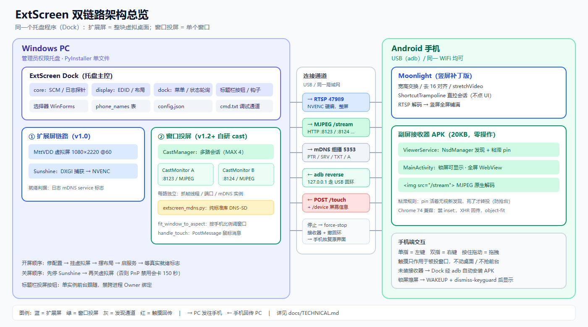
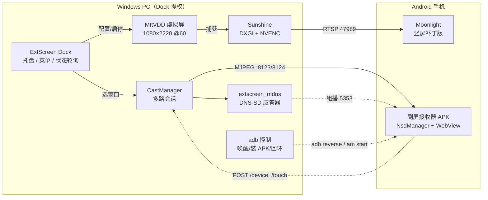
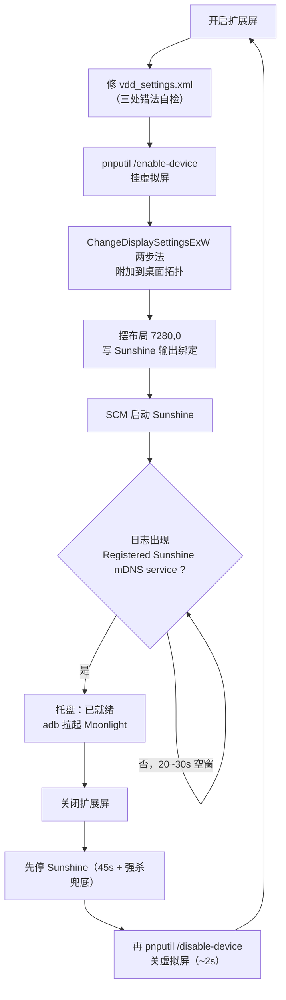
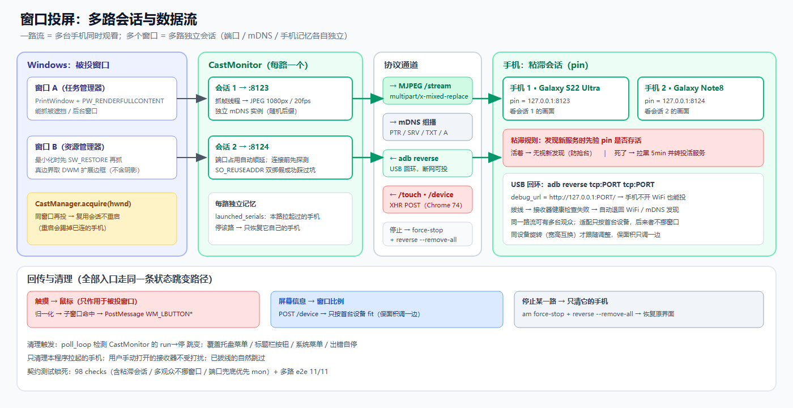
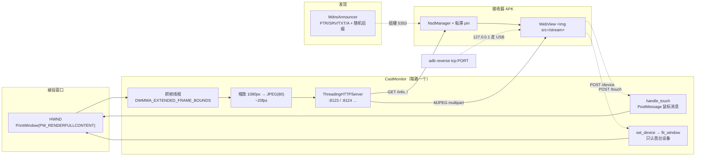
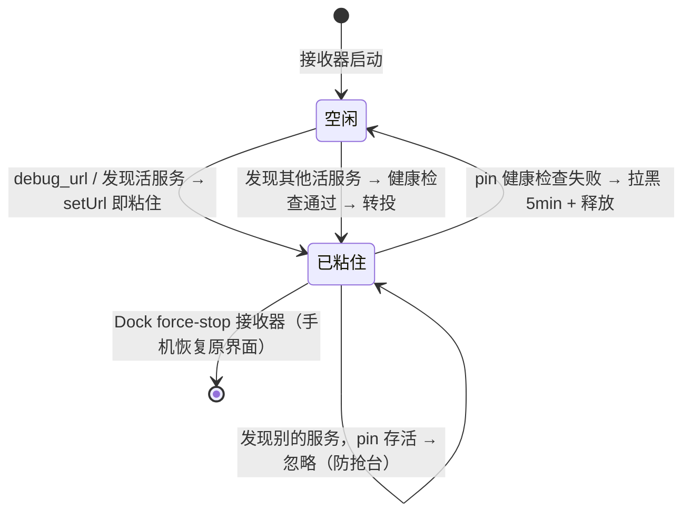
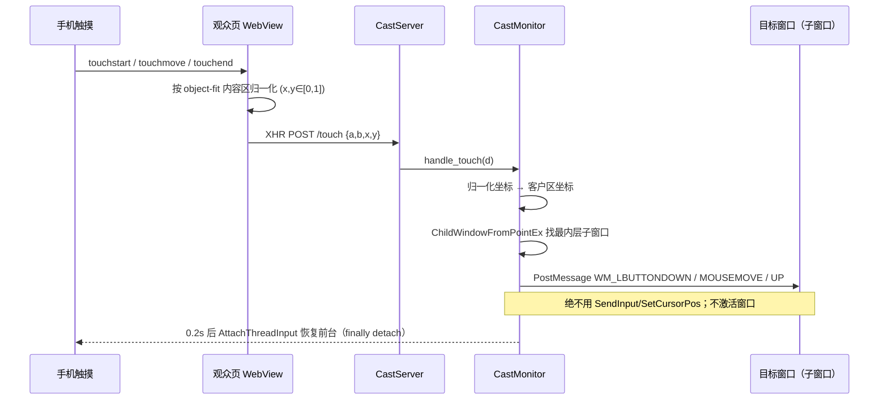
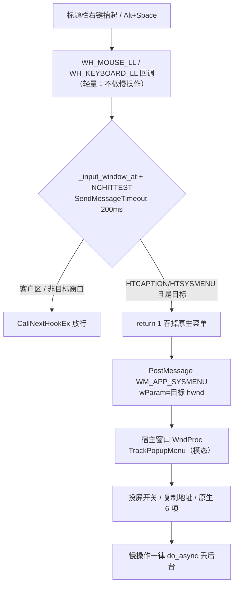

# ExtScreen 技术细节（TECHNICAL）

> 面向维护者/二开者。每条结论都是实测得出的，**别退回去**——每条背后
> 都有一次翻车记录（见 [HISTORY.md](HISTORY.md)）。
> 使用入门看 [README](../README.md)，开发过程看 [HISTORY.md](HISTORY.md)。

项目有两条独立链路，共用一个托盘程序（Dock）：

| | 扩展屏（v1.0） | 窗口投屏（v1.2+） |
|---|---|---|
| 内容 | 整块虚拟桌面 | 单个窗口 |
| 依赖 | VDD 驱动 + Sunshine + Moonlight 补丁版 | 仅接收器 APK（20KB） |
| 协议 | RTSP/NVENC 硬编 | MJPEG over HTTP |
| 延迟 | ~30-60ms | ~100ms |
| 定位 | 真第二块显示器 | 临时把某个窗口放到手上 |

## 架构总览

> 矢量源文件：[architecture-overview.svg](images/architecture-overview.svg)（可直接编辑）。
> 图里 PC 侧的两条链路互不相干；手机侧两个客户端各走各的通道。
> 窗口投屏的会话级细节见 [多路会话与数据流图](images/cast-pipeline.png)。

---

## 一、扩展屏链路（VDD + Sunshine + Moonlight）

### 1.1 架构

### 1.2 关键事实

- **就绪判据用日志标志不用时间差**：`Registered Sunshine mDNS service` = 就绪，
  `Unregistered` = 退出，`CLIENT CONNECTED/DISCONNECTED` = 客户端。
  SCM 的 `SERVICE_RUNNING` 之后还有 20~30s 初始化空窗。
- **日志三条铁律**：只读最新 `sunshine.log`（会滚动 .1~.5）；强杀不打印
  CLIENT DISCONNECTED；客户端判定锚定「最后一个 READY 之后」。
- **虚拟屏按 EDID 匹配**（manufacturer_id=MTT），display_name 每次枚举都变。
- **关屏顺序**：先停 Sunshine 再关屏（DXGI 句柄会让 PnP 禁用卡 150s）；
  关屏用 `pnputil /disable-device`（`Disable-PnpDevice` 在 PS5.1 无 -Timeout）。
- **虚拟屏周期性掉线**：驱动重载后不会自动回到桌面拓扑，用
  `ChangeDisplaySettingsExW` 两步法（CDS_NORESET 写 → NULL 应用）自动重挂。
- **服务启停**走 advapi32 原生 SCM API（sc.exe 输出随系统语言变化）。
- Moonlight 竖屏补丁见 [MOONLIGHT-PATCH.md](MOONLIGHT-PATCH.md)：
  宽高交换方向、去 16 对齐、stretchVideo 强制 true，拉流走
  ShortcutTrampoline（`input tap` 在该机被当长按，不可靠）。

---

## 二、窗口投屏链路（自研 cast 后端）

### 2.1 架构

> 矢量源文件：[cast-pipeline.svg](images/cast-pipeline.svg)。

### 2.2 抓帧与编码

- `PrintWindow(PW_RENDERFULLCONTENT)`：唯一能抓**被遮挡窗口**的方案。
- 窗口尺寸取 `DwmGetWindowAttribute(DWMWA_EXTENDED_FRAME_BOUNDS)`（真边界，
  不含阴影）；GetDIBits 的 biHeight 用负值（自上而下），BGRX 喂 `PIL.frombuffer`。
- 最小化窗口抓不到画面 → 列表里收编（标题带「最小化」后缀），选中投屏时
  先 `SW_RESTORE` 再抓。
- 推流默认 1080px 宽、JPEG 80、20fps（`castWidth/castQuality/castFps` 可调）。
- 窗口最小化/关闭时推占位提示帧（白字黑底），手机端看到说明而不是黑屏。

### 2.3 多路会话（CastManager）

- 每路独立：抓屏线程、HTTP 端口（8123 起顺延，先 connect 探测避开占用，
  Windows `SO_REUSEADDR` 双绑假成功实测踩过）、mDNS 实例（随机后缀防缓存污染）。
- **一路流天然多观众**：同一窗口再投另一台手机时**复用会话不重启**
  （重启的切换语义会踢掉已连的手机）。
- 每路记忆自己的 `launched_serials`；停止该路时只恢复自己的手机。
- **适配只认首台设备**：`set_device()` 首连手机定窗口比例，同设备旋转跟随
  （宽高互换=旋转），后来者只记日志不挪窗口——多观众比例各异，
  谁后到谁说了算会把窗口拉来拉去。

### 2.4 mDNS（extscreen_mdns.py）

纯标准库 DNS-SD 应答器（PTR/SRV/TXT/A + cache-flush 位，单播回源+组播）：

- **Windows 多播必须 `IP_ADD_MEMBERSHIP` + `IP_MULTICAST_IF` 锚定真实网卡**，
  否则查询从虚拟网卡出去永远收不到应答（假阴性）。
- **SRV rdata 的 port 是 2 字节**——曾打成 4 字节导致 Android 解析目标名
  错位、服务永不生效；契约测试有逐字节断言。
- 实例名带随机后缀：每轮都是「新服务」，防 mdnssd 缓存里陈旧记录压着新记录。
- SRV 目标名每会话唯一（`x-<实例名>.local`）：共享 PC 主机名会命中外部/陈旧解析。
- 本地 HTTP 探测一律裸 socket（urllib 走系统代理劫持 127.0.0.1）。

### 2.5 Android 接收器（tools/deskreen-viewer/）

零 Gradle 构建（`build_deskreen_viewer.py`：aapt2→javac→d8→apksigner，
JDK 用 Android Studio 自带 jbr）。

- 前台服务 + NsdManager 发现 `_extscreen-cast._tcp`（兼容 `_extscreen-deskreen`），
  WebView 全屏 ``（MJPEG 浏览器原生解码，Chrome 74 兼容）。
- **粘滞会话（pin）**：`ViewerBridge.setUrl()` 即粘住；发现循环里先验 pin
  存活，活着无视新发现，死了才释放（拉黑 5min + 转投活服务）。
  没有它，多会话场景手机会被 mDNS「抢台」吸到别人的会话上。

- **兼容 Chrome 74**（Note8 WebView）：禁 `inset:` 简写（Chrome 87+）；
  `object-fit: contain` 布局 + 触摸坐标按图片实际内容区归一化。
- **touch 回传必须 XHR**（fetch 在 Chrome 74 同源 POST 也报 Failed to fetch），
  Content-Type 用 text/plain 免预检。
- `setShowWhenLocked+setTurnScreenOn`：锁屏上直接显示画面；
  PC 端拉起前 `input keyevent WAKEUP` + `wm dismiss-keyguard`。
- 设备上报：apply/onResume/onConfigurationChanged 时 `POST /device {w,h,rot}`。
- USB 回环：PC 先 `adb reverse tcp:PORT tcp:PORT`，debug_url 用
  `http://127.0.0.1:PORT/`——**手机不开 WiFi 也能投**（实测断网机拉通）。
  拔线后健康检查失败自动退回 mDNS 发现。

### 2.6 手机选择与商品名

- 选择对话框（WinForms/PowerShell，项目约定）列出窗口（带所属 exe）+
  手机（型号 + 商品名 + Android 版本 + 分辨率 + 对角尺寸）。
- 商品名解析链：`ro.product.marketname` → 本地对照表（`phone_names.json`
  1.1 万条，源自 Google Play 官方 supported_devices.csv，打包进 exe）→
  「未知手机」。**运行时零联网**，用户可手工编辑 exe 旁的 json 补条目。

### 2.7 触摸回传 → 鼠标

- 归一化坐标 → 窗口客户区 → 命中解析到最内层子窗口
  （`ChildWindowFromPointEx` SKIPINVISIBLE|SKIPTRANSPARENT + MapWindowPoints，
  资源管理器实际收消息的是 DirectUIHWND）→ `PostMessage` WM_LBUTTONDOWN/UP、
  WM_MOUSEMOVE（wParam 带 MK_ 标志）。
- **安全边界（不可退回）**：绝不用 SendInput/SetCursorPos/mouse_event
  （那动的是真实光标，会干扰桌面）；PostMessage 不激活窗口。
- 无感操作：`LockSetForegroundWindow(LSFW_LOCK)` 挡程序化抢前台
  （Chromium 收到按下会自己抢，仅 PostMessage 挡不住）+ 触摸后
  AttachThreadInput 恢复前台（detach 必须 finally）。
- **不能给目标窗口挂 WS_EX_NOACTIVATE**：任务栏按钮消失 + 用户点击无反应
  （实测踩过，残留样式还要在 start() 里清）。
- 已知边界：.NET WinForms 不读 WM_MOUSEMOVE 的按键标志，拖拽无效。

### 2.8 快捷入口

- **标题栏按钮**：单 PowerShell 进程 + 单个浮层 Form，`GetForegroundWindow`
  前台跟随——前台窗口合格（WS_CAPTION、非工具窗、非 cloaked、≥220x120、
  非自身）才显示，位置在最小化按钮左侧。颜色由 Dock 每 4s 写
  `caption_state.json` 同步（在投=红「停」）。
  **禁区：不要用跨进程 GWL_HWNDPARENT（Owner）绑定**——Windows 会隐式
  耦合两线程输入队列，浮层进程一卡全桌面窗口失去响应（2026-11-05 事故）。
- **标题栏右键/Alt+Space 接管**：WH_MOUSE_LL/WH_KEYBOARD_LL 低级钩子。
  标题栏右键**不发任何菜单 WinEvent**（探针实测），只能吞掉 RBUTTONUP 后
  用 NCHITTEST 判断。规则：
  - 回调里只做轻量判断，慢操作全 PostMessage 给宿主窗口在 WndProc 弹；
  - NCHITTEST 用 `SendMessageTimeoutW(SMTO_ABORTIFHUNG, 200ms)`——同步
    SendMessage 撞上挂死窗口会拖死全系统输入；
  - 剪贴板/对话框等阻塞调用绝不进钩子线程；
  - 取窗用 Z 序自走跳过 cloaked/穿透窗口（`WindowFromPoint` 会被 Edge
    预启动隐藏窗口全屏挡住，实测踩过）。

### 2.9 停止投屏的清理语义

- 拉起过的手机记录在会话的 `launched_serials`；poll_loop 检测该路
  run→停 跳变（覆盖所有停止路径），对相关手机 `am force-stop` 接收器 +
  `adb reverse --remove-all`——手机退回投屏前的界面。
- 只清理本程序拉起的手机，不碰用户手动开接收器的机器；已拔线自然跳过。
- 部署调试通道 `release/cmd.txt`：Dock 启动时**丢弃残留命令**（曾因残留
  自杀命令导致「启动即死」），执行后自动删除。

### 2.10 配置项（config.json，均有默认值）

| 键 | 默认 | 说明 |
|---|---|---|
| `castPort` | 8123 | 起始端口，占用自动顺延 |
| `castWidth` | 1080 | 推流宽度（手机端显示宽度） |
| `castFps` | 20 | 帧率上限 |
| `castQuality` | 80 | JPEG 质量 |
| `castAdbLaunch` | true | 投屏开始自动经 adb 拉起 USB 手机（含自动装 APK） |
| `castFitWindow` | true | 按手机比例调窗口（保面积，只调一边） |
| `castFitWidth` | 700 | 窗口过小时的兜底宽度 |
| `castFitFollowRotate` | true | 手机旋转时跟随 |
| `castTouchControl` | true | 触摸回传开关 |
| `castNoActivate` | true | 无感操作（前台锁） |

---

## 三、测试矩阵

| 测试 | 覆盖 |
|---|---|
| `test_state_truthfulness.py` (40) | 就绪探针、日志滚动、状态文案、开关方向 |
| `test_action_contract.py` | do_async `(ok, msg)` 契约 |
| `test_cast_contract.py` (98) | mDNS 字节级 SRV、抓帧、触摸、多会话、选择器、
  手机表、粘滞会话、钩子防阻塞等全链路不变量 |
| `test_multi_cast_e2e.py` (11) | 双记事本真投：双端口并存、独立停止、互不干扰 |
| `test_sysmenu_hook.py` | 标题栏右键/Alt+Space 接管命中与拒绝 |

沙箱限制备忘：PowerShell stdout 被吞（验证靠写文件迂回）、sc/wmic/reg 被禁、
提权进程 ~1 分钟被回收（长流程拆短命步骤）、Bash 里跑含 powershell 字样的
python 会被拦（写成文件执行）、固定端口 bind 报 10013（用临时端口）。
